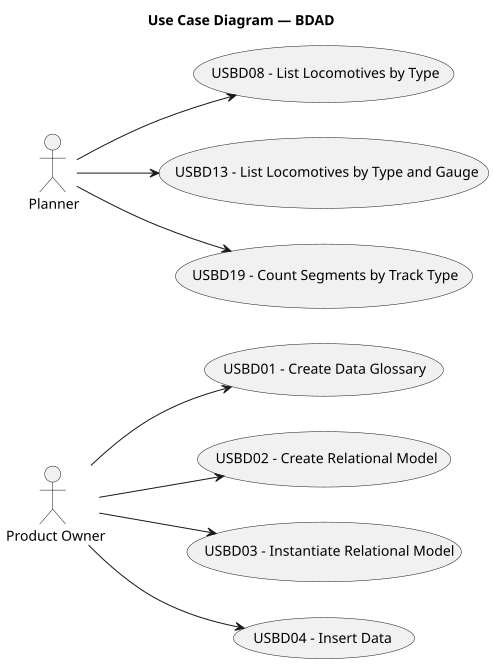

# Use Case Diagram (UCD)

**In the scope of this project, there is a direct relationship of _1 to 1_ between Use Cases (UC) and User Stories (US).**

However, be aware, this is a pedagogical simplification. On further projects and course units there may also exist _1 to N **and/or** N to 1_ relationships between UC and US.

**Insert below the Use Case Diagram in a SVG format**

---

## LAPR3 — Use Case Diagram

**For each UC/US, it must be provided evidences of applying main activities of the software development process (requirements, analysis, design, tests and code). Gather those evidences on a separate file for each UC/US and set up a link as suggested below.**

### Use Cases / User Stories — LAPR3

| UC/US | Description                                                                                                       |
|:------|:------------------------------------------------------------------------------------------------------------------|
| USLP01 | [Create Domain Model](../../USLP01/01.requirements-engineering/USLP01-requirements.md)                           |
| USLP02 | [Access Cargo Handling](../../USLP02/01.requirements-engineering/USLP02-requirements.md)                         |
| USLP03 | [Calculate Travel Time](../../USLP03/01.requirements-engineering/USLP03-requirements.md)                         |

---

## ESINF — Use Case Diagram

**For each UC/US, it must be provided evidences of applying main activities of the software development process (requirements, analysis, design, tests and code).**

### Use Cases / User Stories — ESINF

| UC/US | Description                                                                                                      |
|:------|:-----------------------------------------------------------------------------------------------------------------|
| USEI01 | [Wagons Unloading (Inventory Replenishment)](../../USEI01/01.requirements-engineering/USEI01-requirements.md)   |
| USEI02 | [Order Eligibility & Allocation](../../USEI02/01.requirements-engineering/USEI02-requirements.md)               |
| USEI03 | [Picking Plans](../../USEI03/01.requirements-engineering/USEI03-requirements.md)                                |
| USEI04 | [Pick Path Sequencing](../../USEI04/01.requirements-engineering/USEI04-requirements.md)                         |
| USEI05 | [Returns & Quarantine](../../USEI05/01.requirements-engineering/USEI05-requirements.md)                         |

---

## BDAD — Use Case Diagram

**For each UC/US, it must be provided evidences of applying main activities of the software development process (requirements, analysis, design, tests and code).**

### Use Cases / User Stories — BDAD

| UC/US | Description                                                                                                      |
|:------|:-----------------------------------------------------------------------------------------------------------------|
| USBD01 | [Create Data Dictionary / Glossary](../../USBD01/01.requirements-engineering/USBD01-requirements.md)            |
| USBD02 | [Create Relational Model](../../USBD02/01.requirements-engineering/USBD02-requirements.md)                      |
| USBD03 | [Instantiate Relational Model](../../USBD03/01.requirements-engineering/USBD03-requirements.md)                 |
| USBD04 | [Insert Provided Data](../../USBD04/01.requirements-engineering/USBD04-requirements.md)                         |
| USBD08 | [List Locomotives by Type](../../USBD08/01.requirements-engineering/USBD08-requirements.md)                     |
| USBD13 | [List Locomotives by Type and Gauge per Operator](../../USBD13/01.requirements-engineering/USBD13-requirements.md) |
| USBD19 | [Count Segments per Owner by Track Type](../../USBD19/01.requirements-engineering/USBD19-requirements.md)       |

---

