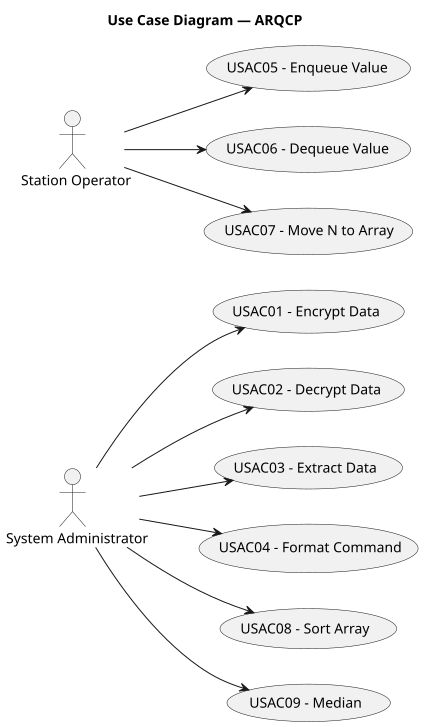
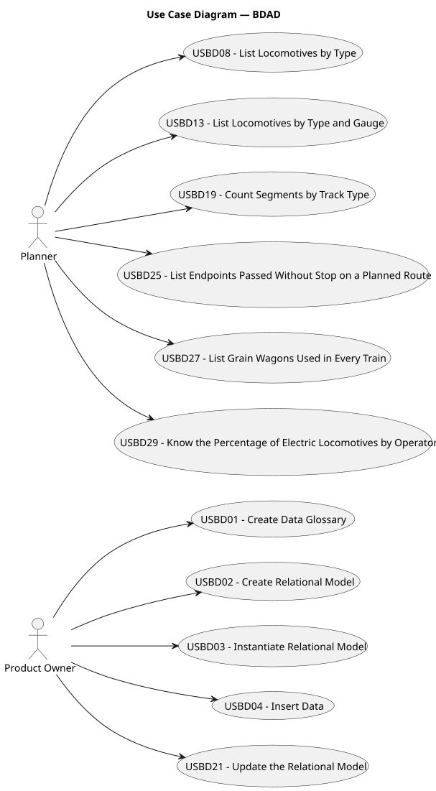
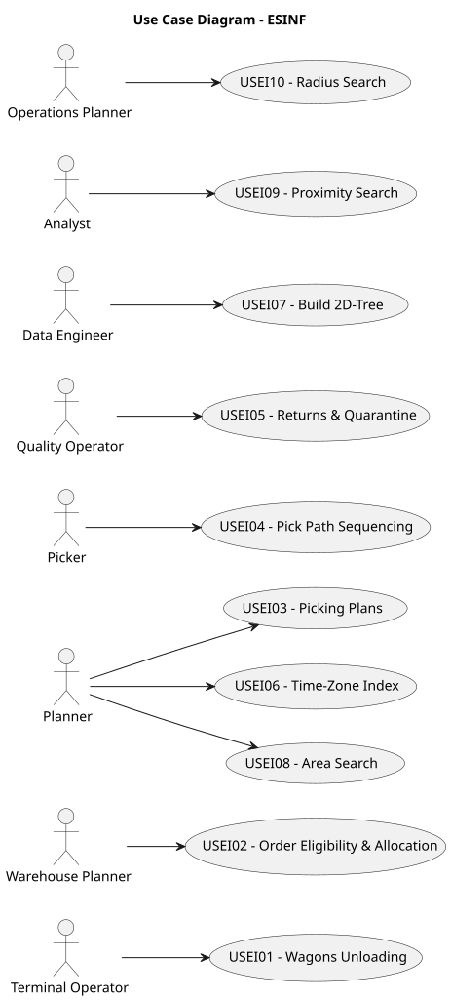
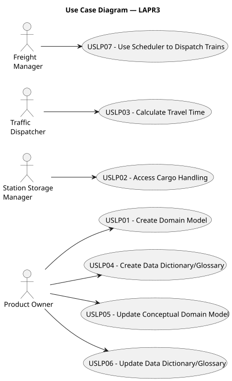

# Use Case Diagram (UCD)

**In the scope of this project, there is a direct relationship of _1 to 1_ between Use Cases (UC) and User Stories (US).**

However, be aware, this is a pedagogical simplification. On further projects and course units there may also exist _1 to N **and/or** N to 1_ relationships between UC and US.

**Insert below the Use Case Diagram in a SVG format**

---

## ARQCP — Use Case Diagram

**For each UC/US, it must be provided evidences of applying main activities of the software development process (requirements, analysis, design, tests and code).**

### Use Cases / User Stories — ARQCP

| UC/US   | Description                            |
|:--------|:---------------------------------------|
| USAC01  | Encrypt Data                           |
| USEAC02 | Decrypt Data                           |
| USEAC3  | Extract Data                           |
| USAC04  | Format Command                         |
| USAC05  | Enqueue Value                          |
| USAC06  | Dequeue Value                          |
| USAC07  | Move N to Array                        |
| USAC08  | Sort Array                             |
| USAC09  | Median                                 |
| USAC10  | Implement Sensors & LightSigns Devices |
| USAC11  | Initial Setup From File                |
| USAC12  | Export User Action Log                 |
| USAC13  | Get Sensor Data                        |
| USAC14  | Control Track LightSign                |
| USAC15  | Send Data to Board                     |
| USAC16  | Manage Station Tracks                  |

---

## BDDAD — Use Case Diagram

**For each UC/US, it must be provided evidences of applying main activities of the software development process (requirements, analysis, design, tests and code).**

### Use Cases / User Stories — BDDAD

| UC/US  | Description                                             |
|:-------|:--------------------------------------------------------|
| USBD01 | Create Data Dictionary / Glossary                       |
| USBD02 | Create Relational Model                                 |
| USBD03 | Instantiate Relational Model                            |
| USBD04 | Insert Provided Data                                    |
| USBD08 | List Locomotives by Type                                |
| USBD13 | List Locomotives by Type and Gauge per Operator         |
| USBD19 | Count Segments by Track Type                            |
| USBD21 | Update the Relational Model                             |
| USBD25 | List Endpoints Passed Without Stop on a Planned Route   |
| USBD27 | List Grain Wagons Used in Every Train                   |
| USBD29 | Know the Percentage of Electric Locomotives by Operator |

---

## ESINF — Use Case Diagram

**For each UC/US, it must be provided evidences of applying main activities of the software development process (requirements, analysis, design, tests and code).**

### Use Cases / User Stories — ESINF

| UC/US  | Description                         |
|:-------|:------------------------------------|
| USEI01 | Wagons Unloading                    |
| USEI02 | Order Eligibility & Allocation      |
| USEI03 | Picking Plans                       |
| USEI04 | Pick Path Sequencing                |
| USEI05 | Returns & Quarantine                |
| USEI06 | Time-Zone Index                     |
| USEI07 | Build 2D-Tree                       |
| USEI08 | Area Search                         |
| USEI09 | Proximity Search                    |
| USEI10 | Radius Search                       |
| USEI11 | Directed Line Upgrade Plan          |
| USEI12 | Minimal Backbone Network            |
| USEI13 | Rail Hub Centrality Analysis        |
| USEI14 | Maximum Throughput Between Two Hubs |
| USEI15 | Risk-Aware Shortest Paths           |

---

## LAPR3 — Use Case Diagram

**For each UC/US, it must be provided evidences of applying main activities of the software development process (requirements, analysis, design, tests and code). Gather those evidences on a separate file for each UC/US and set up a link as suggested below.**

### Use Cases / User Stories — LAPR3

| UC/US  | Description                                   |
|:-------|:----------------------------------------------|
| USLP01 | Create Domain Model                           |
| USLP02 | Access Cargo Handling                         |
| USLP03 | Calculate Travel Time                         |
| USLP04 | Create Data Dictionary/Glossary               |
| USLP05 | Update Conceptual Domain Model                |
| USLP06 | Update Data Dictionary/Glossary               |
| USLP07 | Use Scheduler to Dispatch Trains              |
| USLP08 | Define/Assign Routes for Pending Freights     |
| USLP09 | Assemble and Assign Train to Route            |
| USLP10 | Schedule and Dispatch Trains  |

---
